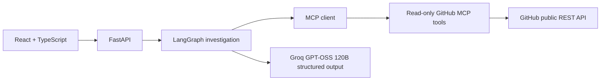

# RepoPilot

An AI GitHub Repository Investigator that reads a bounded slice of a public repository and produces an evidence-backed engineering risk report.

**Live Demo:** Add the deployed frontend URL here after deployment.

## Architecture



LangGraph provides explicit stateful steps, conditional error routing, and accumulated evidence. MCP separates GitHub access from orchestration through five narrow read-only tools. Pydantic validates API, tool, and report boundaries; TypedDict describes internal graph state. The MCP client and server communicate in-process through the MCP protocol, so the backend deploys as one service.

## Stack and limits

Python 3.11+, FastAPI, LangGraph, MCP Python SDK, Pydantic v2, Groq GPT-OSS 120B, guardrails, pytest, DeepEval, React, TypeScript, and Vite.

The investigator inspects at most 12 selected text files, 12 KB per file, 60,000 source characters total, 20 open issues (excluding pull requests), and four dependency manifests. The single Groq prompt includes bounded excerpts of those files, up to six issues, four shortened manifests, and deterministic risk candidates that preserve evidence beyond the excerpts. It ignores build/vendor directories, binary assets, lock files, and oversized files. Large or truncated GitHub trees may omit relevant files. Confidence is constrained when little source can be read.

## Local setup

1. Copy `.env.example` to `backend/.env` and set `GROQ_API_KEY`. `GITHUB_TOKEN` is optional but recommended because unauthenticated GitHub API access is rate limited. Keep the Groq key on the backend only.
2. Start the backend:

   ```bash
   cd backend
   python -m venv .venv
   # Activate the virtual environment for your shell.
   pip install -r requirements-dev.txt
   uvicorn app.main:app --host 0.0.0.0 --port 8000
   ```

3. In another terminal, start the frontend:

   ```bash
   cd frontend
   cp .env.example .env.local
   npm install
   npm run dev
   ```

Open `http://localhost:5173`. `GET /health` returns a readiness response. `POST /api/analyze` accepts `{"repository_url":"https://github.com/owner/repo","question":"Find the biggest engineering risks"}` and returns a validated report, completed trace, and request ID.

## Environment variables

| Variable | Use |
|---|---|
| `GROQ_API_KEY` | Required for analysis and credentialed evaluation; backend only |
| `GROQ_MODEL` | Structured-output model and DeepEval judge; defaults to `openai/gpt-oss-120b` |
| `GITHUB_TOKEN` | Optional read-only token for higher GitHub API capacity |
| `CORS_ORIGINS` | Comma-separated allowed frontend origins |
| `PORT` | Hosting platform backend port |
| `VITE_API_BASE_URL` | Frontend build-time backend URL |
| `RUN_LLM_EVAL` | Set to `1` to enable credentialed DeepEval tests |

## Tests and evaluation

From `backend`, run `pytest -q tests evaluation/test_fixtures.py` for deterministic tests. They mock external boundaries and cover URL validation, GitHub errors and rate limits, redaction, report validation, file selection, and a graph run. The seven fixed fixtures cover credentials, SQL injection, HTTP timeout, retry loop, input validation, shell execution, and healthy code.

Run `RUN_LLM_EVAL=1 pytest -q -s evaluation/test_deepeval.py` with `GROQ_API_KEY` to generate fixture reports and grade answer relevance or evidence faithfulness with Groq as the explicit DeepEval judge. Each fixture uses one judge metric; evaluation runs serially and waits 30 seconds between cases by default. Adjust `GROQ_EVAL_DELAY_SECONDS` for your account's limits. Those tests make model calls and may vary with model behavior. No evaluation scores are claimed unless run.

On PowerShell, set `$env:RUN_LLM_EVAL='1'` before running `pytest -q -s evaluation/test_deepeval.py`.

Frontend production check: `cd frontend && npm run build`.

### Verification snapshot (2026-10-12)

- A real `POST /api/analyze` for `octocat/Hello-World` completed through FastAPI, all ten LangGraph steps, all five MCP tool types, GitHub, Groq GPT-OSS 120B, Pydantic, and the report guard in 7.76 seconds. It inspected one file and no issues, returned zero risks and 0.4 confidence. With zero reported risks, live evidence and file-path checks are vacuous; deterministic guardrail tests cover both checks.
- The deterministic backend and fixture suite passed 36 tests; the React production build passed.
- The credentialed DeepEval suite passed all seven fixtures and the live prompt-injection check. Scores: hard-coded credential 1.0, SQL injection 1.0, missing HTTP timeout 1.0, unbounded retry 0.8, weak input validation 1.0, unsafe shell 1.0, healthy simple code 1.0. No Groq rate-limit failure occurred. One initial retry-loop fixture run produced no risk; a prompt refinement resolved it, and the complete suite passed on rerun.

## Security and failure handling

Repository content and issue text are untrusted data. Model instructions explicitly say to ignore instructions inside them. Likely credentials are redacted before prompting and in final output. The report guard drops risk evidence absent from inspected content and validates affected file paths. These controls reduce, but cannot eliminate, prompt injection or secret leakage. GitHub tools expose only reads, use fixed GitHub API hosts, and never log credentials or source text. Operational logs record request ID, graph node or MCP tool, duration, and outcome.

Invalid URLs, missing repositories, GitHub rate limits and timeouts, MCP failures, and model errors return user-facing errors without stack traces. No retry is made for GitHub 4xx errors. Groq minute limits use bounded backoff with jitter and honor `Retry-After`; daily limits return immediately without retry. Model work has a 50-second deadline.

## Deployment

**Backend on Render/Railway:** Deploy `backend` as the root directory using the Dockerfile, or use build command `pip install -r requirements.txt` and start command `uvicorn app.main:app --host 0.0.0.0 --port $PORT`. Set `GROQ_API_KEY` in the hosting secret manager, `GROQ_MODEL=openai/gpt-oss-120b`, optionally `GITHUB_TOKEN`, and set `CORS_ORIGINS` to the exact Vercel frontend origin. Health check: `/health`.

**Frontend on Vercel:** Import this repository, set root directory to `frontend`, framework preset Vite, build command `npm run build`, output directory `dist`, and `VITE_API_BASE_URL` to the public HTTPS backend origin. Redeploy after changing this build-time variable.

## Known limitations

Only public GitHub repositories are supported. Analysis samples files and recent open issues, so findings are not exhaustive. Secret detection and deterministic risk candidates are heuristic. Reports require a Groq API key; unauthenticated GitHub calls have a low shared rate limit. The investigation trace is returned when analysis finishes, without live streaming.
